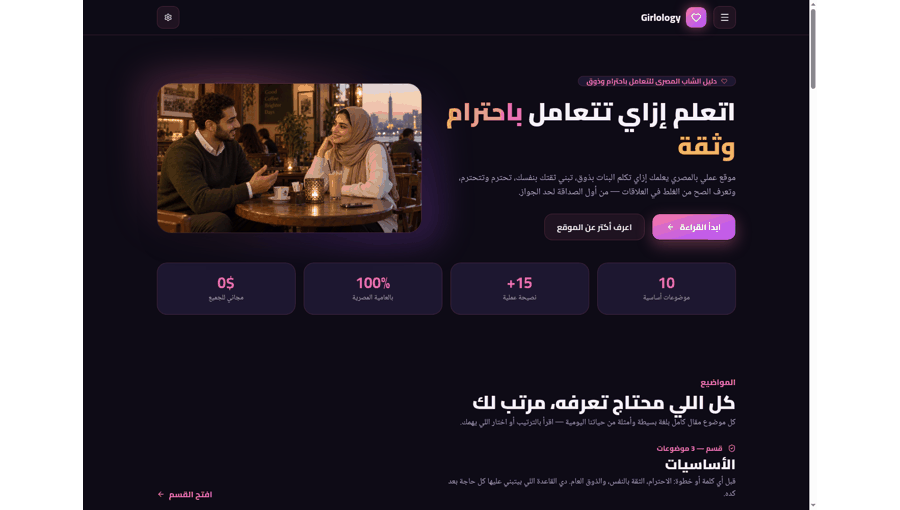
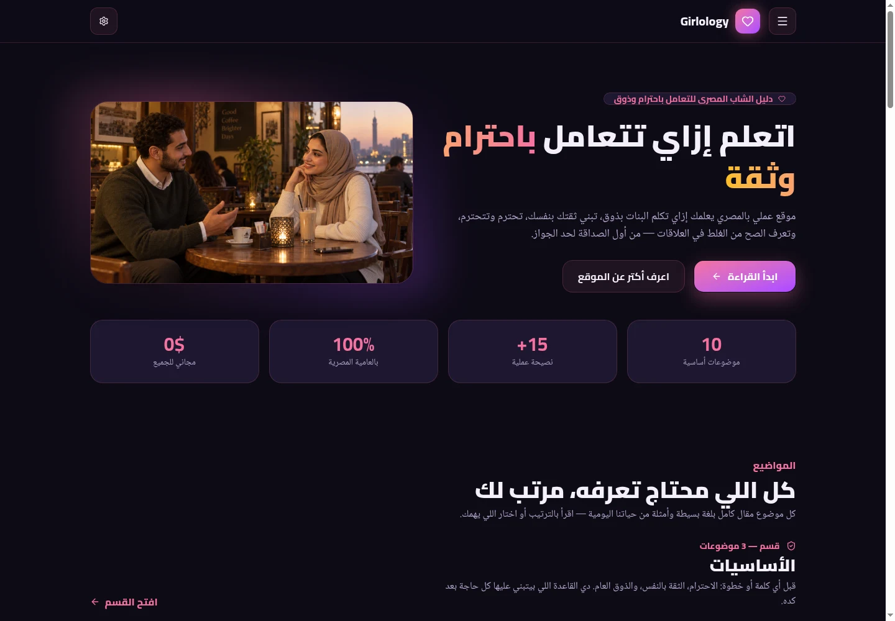
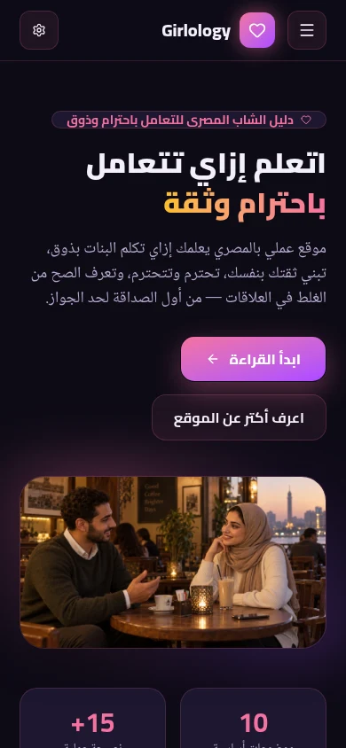

# Girlology

**فن التعامل المحترم — دليل الشاب المصري للتعامل مع البنات باحترام وذوق وثقة**

A premium, fully bilingual (Egyptian Arabic / English) guide site about respectful communication and relationships: how to talk, listen, build confidence, keep clean friendships, handle rejection with dignity, and walk the honest path to marriage — no tricks, no manipulation, just character.

## Live site and demo

**[Open Girlology](https://girlology.pages.dev/)**

Captured from the live Arabic site on 18 November 2026. The short GIF cycles through home, the foundations section and the respect article. These are actual navigation captures, not generated mockups.

[](https://girlology.pages.dev/)

| Desktop | Mobile |
| --- | --- |
|  |  |

[Foundations](https://girlology.pages.dev/section/foundations/) · [Read about respect](https://girlology.pages.dev/article/respect/)

## Topics

1. **الاحترام أساس كل حاجة** — Respect comes first
2. **إزاي تتكلم معاها** — How to talk to her
3. **فن الاستماع** — The art of listening
4. **الثقة بالنفس من غير غرور** — Confidence without arrogance
5. **الذوق والآداب في التعامل** — Manners and etiquette
6. **الصداقة بين الولد والبنت** — Friendship between a guy and a girl
7. **لما يعجبك حد.. تتصرف إزاي؟** — When you like someone
8. **إزاي تتعامل مع الرفض** — Handling rejection
9. **الخطوبة والجواز بالمعروف** — The honest path to marriage
10. **أخطاء شائعة بتبوظ كل حاجة** — Common mistakes that ruin everything

## Features

- Egyptian Arabic (RTL) and English (LTR) with instant language switch
- Dark and light premium themes
- Listen to any article (browser text-to-speech, Arabic voice)
- Favorites and reading progress saved locally in the browser
- A relevant, expressive image on every card
- Fully static, fast, and free to host

## Stack

- Next.js 15 (static export) + React 19 + TypeScript
- Tailwind CSS 4 + shadcn/ui components (button, card, sheet, switch, badge, separator)
- Lucide SVG icons
- Deployed on Cloudflare Pages: [girlology.pages.dev](https://girlology.pages.dev/)

## Run locally

```bash
npm install
npm run build
# static site is exported to ./out
```
